

  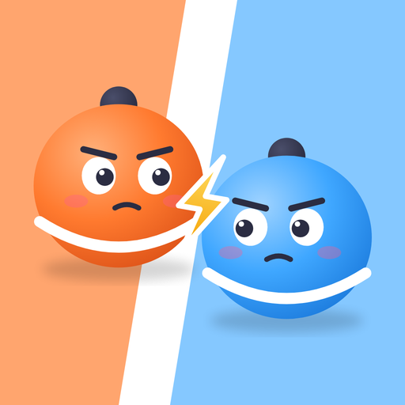
  <h1>Duo Arena: 2 Player Games</h1>
  
<b>ألعاب ثنائية مصغرة أونلاين بالوقت الفعلي لشخصين (ويب وأندرويد)</b> 
  Real-Time Online 2-Player Mini Games (Three.js · WebSockets · Android)

  
تطوير / Developed with ❤️ by <b>MhDTam</b>

  
   

  

    
  
🌐 <b>رابط اللعبة المباشر للتجربة:</b> 
  <a href="https://duo-arena-ali313.onrender.com">https://duo-arena-ali313.onrender.com</a>

---

### 🎮 Games Gallery / معرض الألعاب

| Mini Soccer | Tanks Duel | Kart Racing | Archery |
|:---:|:---:|:---:|:---:|
| 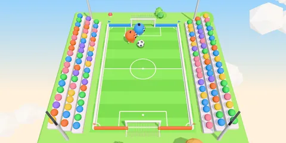 | 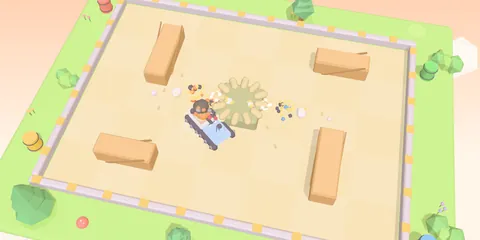 | 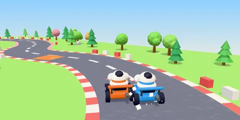 | 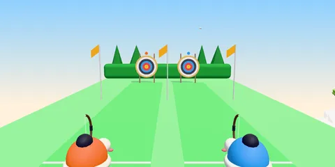 |

| Boxing | Tennis | Air Hockey | Bowling |
|:---:|:---:|:---:|:---:|
| 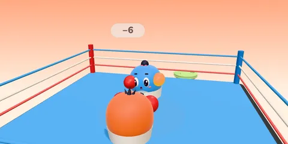 | 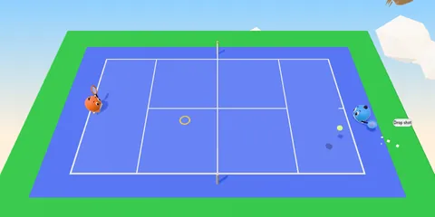 | 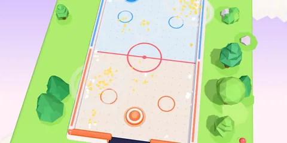 | 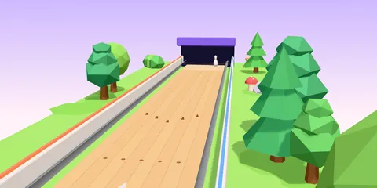 |

| Ping Pong | Snowball Fight | Sumo Bumpers | Obstacle Runner |
|:---:|:---:|:---:|:---:|
| 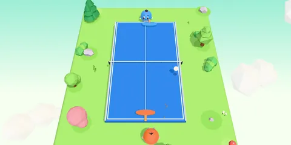 | 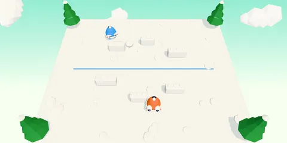 | 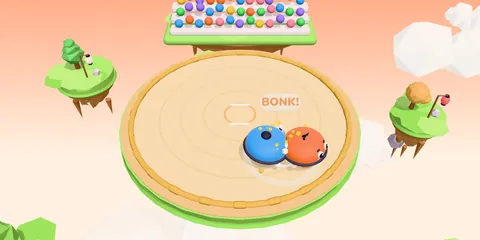 | 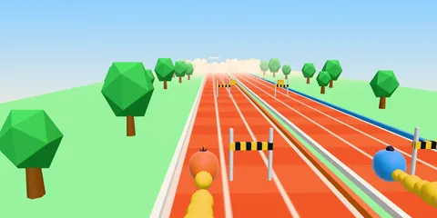 |

| Castle Siege | Penalty Kicks | 8-Ball Pool | Prop Hunt |
|:---:|:---:|:---:|:---:|
| 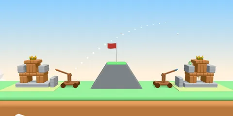 | 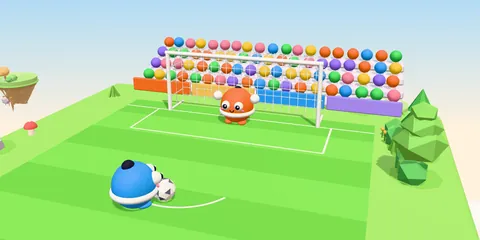 | 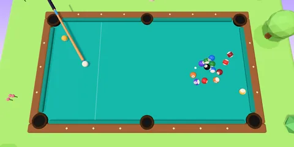 | 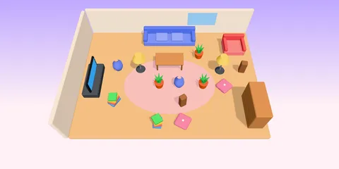 |

---

### 🌟 المميزات الرئيسية / Key Features
- **أكثر من 65 لعبة مصغرة:** تشمل ألعاب الحركة، الرياضة، الذكاء، الألغاز، والفيزياء الواقعية لشخصين.
- **لعب أونلاين بالوقت الفعلي (Real-Time Multiplayer):** مزامنة فائقة السرعة وسلسة بـ 60 إطار بالثانية (60 fps) عبر WebSockets.
- **إمكانية اللعب الفردي ضد البوت (Play vs Bot):** ذكاء اصطناعي متعدد المستويات (سهل، متوسط، صعب) يعمل محلياً.
- **واجهة ثنائية اللغة:** دعم كامل للغة العربية (RTL) واللغة الإنجليزية.
- **تعمل على جميع الأجهزة:** مصممة للعمل بسلاسة على الهواتف الذكية (Touch Controls) والحواسيب والمتصفحات.
- **استعادة الاتصال والتفاعل:** إمكانية العودة للمباراة خلال 15 ثانية، مع تفاعلات الإيموجي والملف الشخصي والمهام اليومية.

---

## Copyright & License
Copyright © 2026 **MhDTam**. All rights reserved.  
جميع الحقوق محفوظة للمطور **MhDTam**.  
This project, including its source code, assets, and game simulations, is proprietary and private. Unauthorized copying, modification, redistribution, or commercial use is strictly prohibited.
